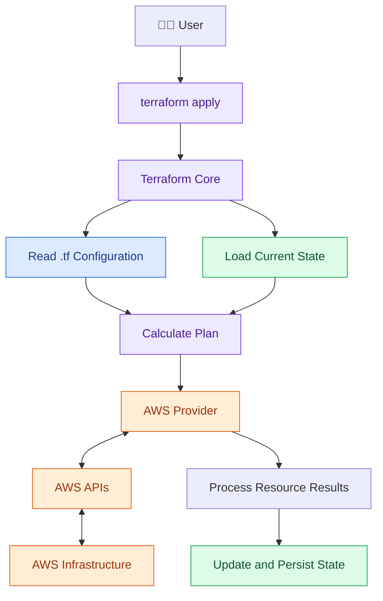
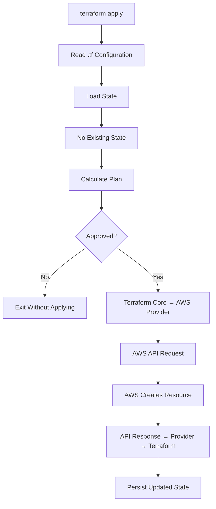
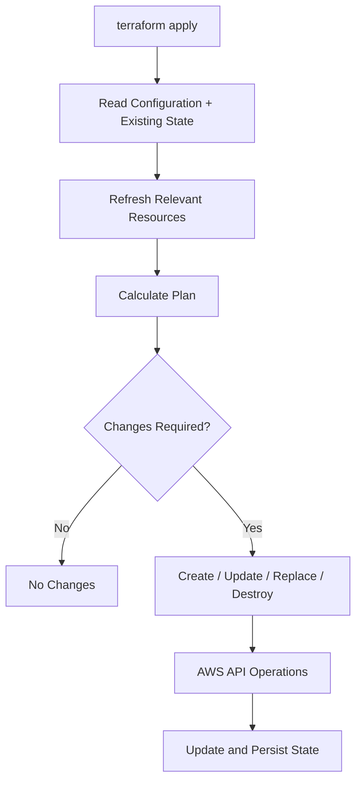

# Terraform Statefile (.tfstate)

<p align="center">
  
  
  
</p>

## 📌 What Is a Terraform Statefile?

The `.tfstate` file stores information about infrastructure resources managed by Terraform, including resource identities and tracked attributes.

Terraform uses three sources to determine the required infrastructure changes:

- 📄 **`.tf` configuration:** What infrastructure is desired?
- 💾 **`.tfstate` file:** Which resources does Terraform track?
- ☁️ **Actual infrastructure:** What currently exists in AWS?

---

## 🏗️ Architecture



### 🔄 First `terraform apply`

When no previous state exists, Terraform starts with an empty initial state.



**Important:** Terraform does not need to create an empty statefile on disk before the first AWS API call. It can use an empty initial state and persist the resulting state during execution.

### 🔁 Subsequent `terraform apply`

When state already exists, Terraform loads it and uses it alongside configuration and refreshed infrastructure information to calculate changes.



---

## 🌐 AWS API Workflow

1. **Terraform Core** loads the configuration and state.
2. Terraform calculates the execution plan, refreshing relevant resources as needed.
3. After approval, Terraform Core coordinates the planned operations with the AWS Provider.
4. The **AWS Provider** sends the appropriate API requests to AWS.
5. AWS returns API responses to the provider.
6. The provider processes the results, and Terraform updates and persists the state.

```text
User
  |
  v
terraform apply
  |
  v
Terraform Core
  |              |
  v              v
.tf Config    .tfstate
  |
  v
Execution Plan
  |
  v
AWS Provider
  |
  v
AWS API <-----> AWS Infrastructure
  |
  v
Updated State
```

---

## ⚖️ Create, Update and Destroy

| Situation | Terraform action |
|---|---|
| Resource is required but not managed | Plan creation, subject to imports and configuration |
| Tracked resource needs an in-place change | Update the resource |
| Change requires replacement | Destroy and recreate as planned |
| Managed resource is removed from configuration | May plan destruction |
| No changes are required | Report `No changes` |

**Note:** Terraform does not automatically discover and manage every resource in your AWS account. Existing resources generally require appropriate configuration and an import operation.

---

## 🧪 Useful Commands

```bash
terraform init
terraform validate
terraform plan
terraform apply
terraform state list
terraform state show aws_instance.web
terraform show
```

| Command | Purpose |
|---|---|
| `terraform init` | Initialize the working directory and backend |
| `terraform plan` | Preview infrastructure changes |
| `terraform apply` | Execute planned changes |
| `terraform state list` | List tracked resources |
| `terraform show` | Display state or saved plan information |

---

## 🔐 Best Practices

- 🚫 Never commit statefiles or state backups to a public repository.
- 🔒 Restrict access because state may contain sensitive information.
- ☁️ Consider a remote backend for team collaboration.
- 🔄 Use appropriate state locking where supported.
- ⚠️ Avoid manually editing or deleting statefiles.
- 💾 Maintain secure backups and recovery procedures.

Example `.gitignore`:

```gitignore
*.tfstate
*.tfstate.*
.terraform/
*.tfplan
```

---

## 🎯 Key Takeaways

- `.tf` defines the desired infrastructure.
- `.tfstate` records Terraform-managed resources and their tracked attributes.
- AWS holds the actual infrastructure.
- Terraform uses configuration, state, and refreshed infrastructure information to determine changes.
- Every execution loads the current state, but an empty statefile does not necessarily have to be created on disk before the first AWS API request.
- AWS API responses return to the provider, and Terraform persists the resulting state.

**Terraform does not count requests. It calculates actions from the current configuration, state, and infrastructure information.**

<p align="center">
  <b>🚀 Infrastructure as Code • Terraform • AWS</b>
</p>