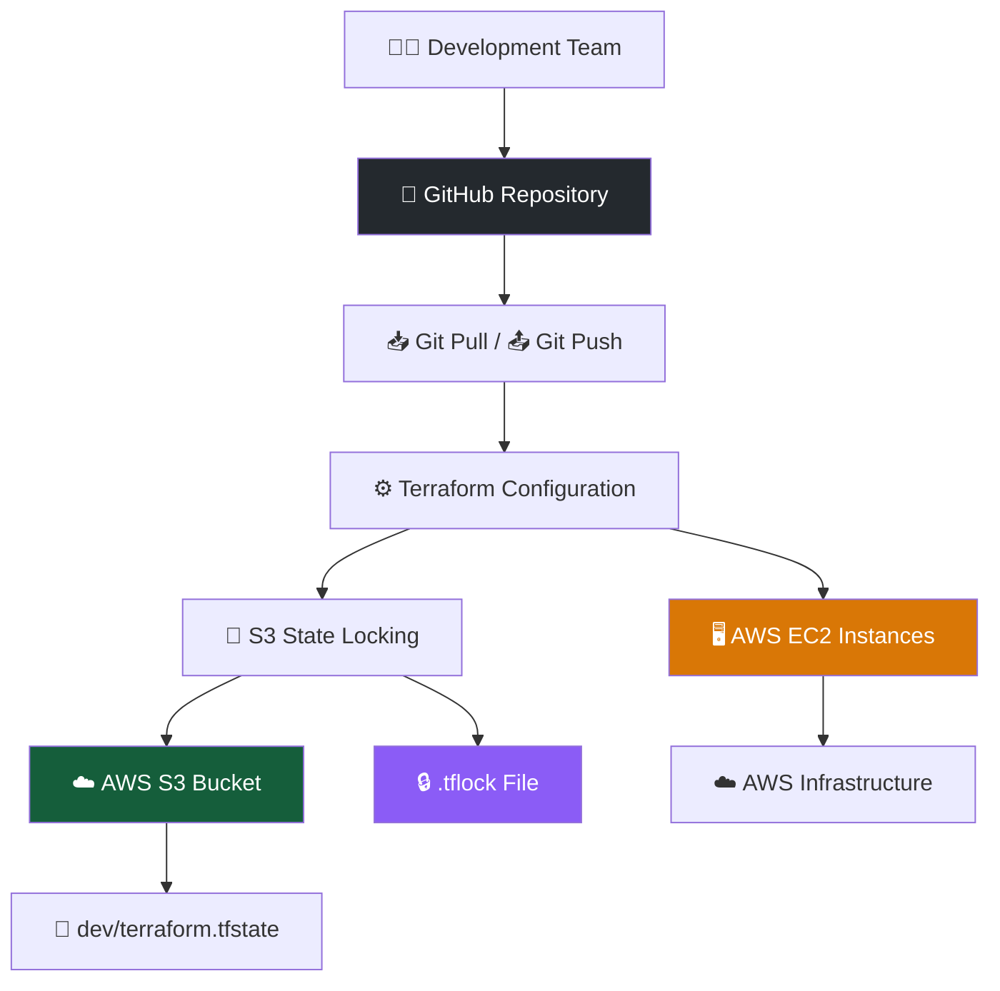
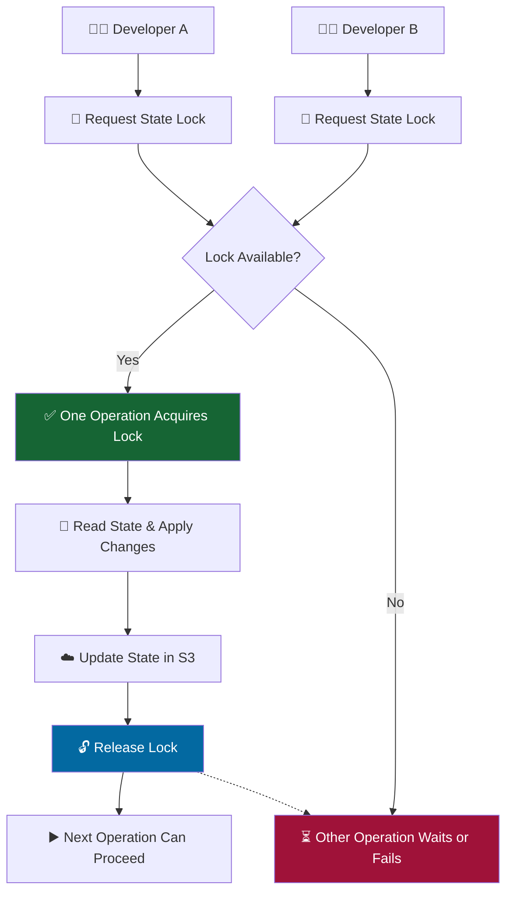
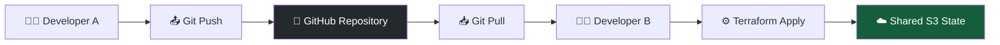

# 🚀 Terraform AWS — Remote State & S3 Native Locking

Configure Terraform with **AWS S3 Remote State, Native State Locking, and EC2 Instances** for secure and collaborative Infrastructure as Code (IaC).

## 🏗️ Project Architecture



## ✨ Key Features

- ☁️ **Remote State:** Stores Terraform state centrally in Amazon S3.
- 🛡️ **State Security:** Keeps state files out of GitHub, reducing the risk of exposing sensitive infrastructure data.
- 🕒 **S3 Versioning:** Helps recover previous versions of the state file.
- 🔐 **Native State Locking:** Uses `use_lockfile = true` to coordinate concurrent Terraform operations.
- 👥 **Team Collaboration:** Git tracks changes to Terraform configuration files.
- 🖥️ **EC2 Provisioning:** Creates and manages AWS EC2 instances using Terraform.

## 📁 Project Structure

```text
day-4-state-backend-remote-location/
│
├── .terraform.lock.hcl  # Provider dependency lock file
├── backend.tf           # S3 remote backend configuration
├── provider.tf          # AWS provider and region
├── main.tf              # EC2 resource definitions
└── day-4-README.md      # Project documentation
```

## ☁️ Why Store the State in S3?

Terraform's `terraform.tfstate` file tracks managed resources and their attributes. It may contain sensitive information, so it should not be committed to a public GitHub repository.

This project stores the state remotely in S3 instead of tracking it in Git.

**📍 Remote State Location**

```text
S3 Bucket: terraform-statefile-remote-bucket
└── dev/
    └── terraform.tfstate
```

The backend's `key` determines this object path.

### 🔒 Why Amazon S3?

- **Security:** Supports IAM access control and server-side encryption.
- **Versioning:** Helps recover earlier state versions when bucket versioning is enabled.
- **Centralized Storage:** Team members using the same backend and key access the same remote state.
- **Native Locking:** Supports S3 lock files without requiring a DynamoDB table.

> ⚠️ **Security Best Practice:** Enable S3 bucket versioning to help recover previous state versions, and use IAM policies and bucket policies to restrict access to authorized users and services.

## ⚙️ Terraform Configuration

### 1. S3 Backend — `backend.tf`

```hcl
terraform {
  backend "s3" {
    bucket       = "terraform-statefile-remote-bucket"
    key          = "dev/terraform.tfstate"
    region       = "us-east-1"
    encrypt      = true
    use_lockfile = true
  }
}
```

**Important:** The S3 bucket must already exist, and the AWS identity running Terraform needs the appropriate S3 permissions for state and lock-file operations.

### 2. AWS Provider — `provider.tf`

```hcl
provider "aws" {
  region = "us-east-1"
}
```

The provider region determines where the EC2 resources are managed. The backend region is separate and identifies the S3 bucket's region.

### 3. EC2 Resources — `main.tf`

Define your EC2 resources using `aws_instance`, a valid AMI ID for the selected region, and a compatible instance type.

## 🔐 How State Locking Works

Suppose two developers run `terraform apply` at nearly the same time using the same remote state.



### 🔄 Step-by-Step Workflow

1. Developer A and Developer B both initiate a Terraform operation.
2. Terraform attempts to acquire the lock for the shared state.
3. Only one operation acquires the lock; the other cannot proceed with a conflicting state-changing operation while the lock is held.
4. The lock holder reads the current state, plans and applies changes, then updates the remote state.
5. Terraform releases the lock after the operation finishes.
6. The waiting operation may then acquire the lock and continue, provided its operation remains valid.

**Key takeaway:** State locking coordinates concurrent operations on the same state. It does not lock the GitHub repository or prevent developers from editing `.tf` files simultaneously.

## 🗄️ S3 Locking vs. DynamoDB Locking

| Feature | S3 Native Locking | DynamoDB Locking |
|---|---|---|
| Configuration | `use_lockfile = true` | `dynamodb_table` |
| Lock storage | S3 `.tflock` object | DynamoDB table |
| Recommendation | ✅ Preferred for new configurations | ⚠️ Deprecated |
| Terraform version | 1.10.0+ | Legacy approach |

Terraform has deprecated DynamoDB-based locking in favor of S3-native lock files. For new configurations, prefer `use_lockfile = true`. Do not configure both unless you have a specific migration or compatibility requirement.

## 🔄 Why Git Pull & Push Are Important

Terraform configuration files remain in GitHub so the team can review, share, and version-control infrastructure code.



Use Git to keep local configuration synchronized:

```bash
# Get the latest team changes
git pull origin main

# Stage and commit your changes
git add .
git commit -m "Update Terraform configuration"

# Push changes to GitHub
git push origin main
```

**Remember:**
- `git pull` fetches and integrates remote repository changes.
- `git push` publishes your committed changes to GitHub.
- S3 stores the shared Terraform state; Git does not synchronize that state.
- Pull the latest configuration and review changes before running Terraform.

## ▶️ Execution Workflow

```bash
# Initialize the backend and providers
terraform init

# Preview infrastructure changes
terraform plan

# Create or update resources
terraform apply

# List resources tracked in state
terraform state list

# Destroy managed resources when no longer needed
terraform destroy
```

If the backend configuration changes, use `terraform init -reconfigure` when reinitialization without state migration is intended. Use `terraform init -migrate-state` when migrating an existing state to a new backend.

## 🛡️ Best Practices

- Never commit `terraform.tfstate`, `.tflock` files, or AWS credentials to GitHub.
- Commit `.terraform.lock.hcl` to keep provider dependency selections consistent.
- Enable S3 bucket versioning and restrict bucket access.
- Use Terraform v1.10.0 or later for S3-native locking.
- Keep the backend bucket and key consistent among team members working on the same state.
- Coordinate infrastructure changes and review plans before applying them.
- Run `terraform destroy` only when you intend to delete the managed infrastructure.

---

**Built with ❤️ for learning Terraform, AWS, Remote State Management, and Team Collaboration.**
